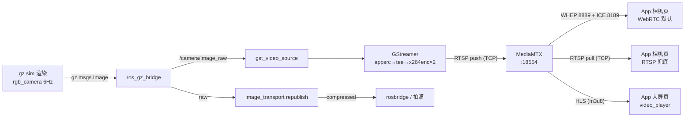

# 视频流全链路：从 Gazebo 相机到 Flutter Widget

> 适用项目：`/home/dxw/amr`。
> 读者假设：有 iOS 背景、Flutter 只有基础。必要时用 UIKit 类比，但不展开 iOS 侧。
> 本文所有结论来自源码阅读 + 此前实测；凡未读源码处均显式标注「推断」。
> 全程只读说明：本文档不涉及任何代码/配置修改，也不要求启动或停止进程。

---

## 0. 全景数据流

```
[Gazebo 服务端渲染]
  gz sim -s (indoor.world) + amr_camera.xacro 的 rgb_camera 传感器
        │  gz topic: camera/image_raw  (320x240@5Hz, R8G8B8)
        ▼
[ros_gz_bridge]
  parameter_bridge + bridge_topics.yaml  (GZ_TO_ROS)
        │  ROS 2 topic: /camera/image_raw  (sensor_msgs/Image, ~5Hz 消息 / 0.61Hz 新内容)
        ├──────────────► image_transport republish ──► /camera/image_raw/compressed（只给"拍照"）
        ▼
[gst_video_source 节点]
  cv_bridge(BGR8) → 画时间戳水印 → appsrc(PTS=monotonic)
        │
        ▼
[GStreamer 管线]
  appsrc → videoconvert → tee ─┬─ queue(leaky) → videoscale → I420 320x240 → x264enc(main 700k) → rtspclientsink ─┐
                               └─ queue(leaky) → videoscale → I420 160x120 → x264enc(low 220k) → rtspclientsink ─┤
                                                                                                                 ▼
[MediaMTX]
  RTSP :18554  (publisher 推入 path camera / camera_low)
  WHEP :8889 (相机页默认)   ICE :8189 (WebRTC 媒体面)   HLS :18888 (大屏用)
        │  WebRTC(WHEP 8889 + ICE 8189) 或 RTSP(TCP 18554)
        ▼
[Flutter App]
  相机页默认: WebRTC → RTCVideoView（渲染器直贴）
  相机页兜底: RTSP → video_player + fvp → VideoPlayer Widget（Texture 上屏）
  大屏页:     HLS  → VideoPlayer Widget
```



---

## 1. Gazebo 相机：定义在哪、参数是多少、为什么掉帧

### 1.1 相机不在 world 里，而在 xacro 里

[indoor.world](../amr_sim_ws/src/amr_gazebo/worlds/indoor.world#L12-L19) 只负责加载传感器系统插件并指定渲染引擎：

```xml
<plugin filename="gz-sim-sensors-system" name="gz::sim::systems::Sensors">
  <render_engine>ogre2</render_engine>
</plugin>
```

相机本体在 [amr_camera.xacro](../amr_sim_ws/src/amr_description/urdf/amr_camera.xacro#L42-L66)：

| 项目 | 值 | 行号 |
|---|---|---|
| 传感器类型 | `type="camera"`，名字 `rgb_camera` | [L43](../amr_sim_ws/src/amr_description/urdf/amr_camera.xacro#L43) |
| gz 话题 | `camera/image_raw`（无前导斜杠，由 gz 侧解析） | [L45](../amr_sim_ws/src/amr_description/urdf/amr_camera.xacro#L45) |
| frame_id | `camera_optical_link` | [L46](../amr_sim_ws/src/amr_description/urdf/amr_camera.xacro#L46) |
| 更新率 | `5` Hz | [L51](../amr_sim_ws/src/amr_description/urdf/amr_camera.xacro#L51) |
| 分辨率 | 320×240 | [L55-L58](../amr_sim_ws/src/amr_description/urdf/amr_camera.xacro#L55-L58) |
| 像素格式 | `R8G8B8`（≈ ROS 的 rgb8） | [L58](../amr_sim_ws/src/amr_description/urdf/amr_camera.xacro#L58) |
| 水平 FOV | 1.047 rad ≈ 60° | [L54](../amr_sim_ws/src/amr_description/urdf/amr_camera.xacro#L54) |
| 裁剪 | near 0.05 / far 30 m | [L60-L63](../amr_sim_ws/src/amr_description/urdf/amr_camera.xacro#L60-L63) |
| 安装位置 | `top_link` 前壁，x=0.165 m | [L35-L40](../amr_sim_ws/src/amr_description/urdf/amr_camera.xacro#L35-L40) |

相机另有一个 `camera_optical_link`（z 朝前、x 朝右、y 朝下），这是 ROS 相机标准光学坐标系约定，见 [L27-L33](../amr_sim_ws/src/amr_description/urdf/amr_camera.xacro#L27-L33)。理解这一点很关键：**图像里的"右"是机器人坐标系的 +y**，做视觉定位时不要搞反。

### 1.2 为什么只有 320×240@5Hz

[xacro 注释](../amr_sim_ws/src/amr_description/urdf/amr_camera.xacro#L47-L50) 已写明原因：

> 软件渲染（llvmpipe）下摄像头是主要渲染负载，且与 gpu_lidar 共用 ogre2 渲染队列：640×480@15Hz 曾拖垮渲染管线，导致 `/scan` 时间戳持续滞后 `/clock`（SLAM 发散根因）。降为 320×240@5Hz，像素吞吐降 16 倍。

也就是说：这里降的是 **640×480→320×240、15Hz→5Hz，像素吞吐降 16 倍**，不是为了省流量。

headless（`gz sim -s`，见 [sim_bringup.launch.py L39-L44](../amr_sim_ws/src/amr_gazebo/launch/sim_bringup.launch.py#L39-L44)）**并不等于不渲染**：`-s` 只关掉 GUI 窗口，相机传感器仍然由服务端渲染，仍然走 ogre2/llvmpipe。

### 1.3 5 Hz 消息率 vs 0.61 Hz 内容更新率

此前**实测**：`/camera/image_raw` 消息频率稳定 5.00 Hz，但 9.8 s 窗口里只有 6 帧内容不同（0.61 Hz），最长冻结 1.2 s；行驶中抓 44 帧 RTSP，其中 40 帧像素完全相同。

分两层：

1. **消息率 5 Hz 是"传感器节拍"，不是"新画面率"。** 传感器按 `update_rate` 周期发布；渲染线程来不及产出新帧时，仍按节拍把上一帧缓冲再发一次。
2. **新画面率被渲染能力卡住。** 相机与 gpu_lidar 共用 ogre2 渲染队列，llvmpipe 是纯 CPU 光栅化，单帧渲染超过 200 ms 时，实际出图就掉到 1 Hz 以下。

> 说明：`gz-sim` 的 CameraSensor 与 Sensors 系统内部如何判定"渲染完成/复用上一帧"，这里**未读源码，以上为推断**。但"5 Hz 消息 + 0.61 Hz 新内容 + 最长冻结 1.2 s"这组实测数据与"渲染线程是瓶颈"的解释自洽，也与 xacro 注释里记录的历史事故（`/scan` 时间戳追不上 `/clock`）吻合。

**这条结论对排查极重要**：App 里"画面卡"，第一嫌疑不是网络也不是编码器，而是**源头没有新内容**。

---

## 2. gz 话题 → ROS 2 话题：ros_gz_bridge

- 启动：[sim_bringup.launch.py L73-L79](../amr_sim_ws/src/amr_gazebo/launch/sim_bringup.launch.py#L73-L79)，用 `parameter_bridge` + 配置文件。
- 配置：[bridge_topics.yaml L42-L46](../amr_sim_ws/src/amr_gazebo/config/bridge_topics.yaml#L42-L46) 声明 `gz.msgs.Image → sensor_msgs/msg/Image`，方向 `GZ_TO_ROS`。
- 压缩图是另一条路：[bridge_topics.yaml L48-L50](../amr_sim_ws/src/amr_gazebo/config/bridge_topics.yaml#L48-L50) 说明 ros_gz_bridge 无 Image→CompressedImage 特化，因此由 [full_bringup.launch.py L116-L127](../amr_sim_ws/src/amr_bringup/launch/full_bringup.launch.py#L116-L127) 的 `image_transport republish` 生成 `/camera/image_raw/compressed`，**只服务"拍照"**，不参与预览。

延迟量级：局域网 DDS + 一次消息序列化，**1–10 ms**（估算，未实测）。

---

## 3. ROS 2 侧取帧：gst_video_source.py

文件：[gst_video_source.py](../amr_sim_ws/src/amr_gazebo/scripts/gst_video_source.py)。它本质是 **ROS 节点 + GStreamer 宿主**：ROS 负责"拿到帧"，GStreamer 负责"编码 + 推流"。

### 3.1 参数（可调旋钮）

[L66-L83](../amr_sim_ws/src/amr_gazebo/scripts/gst_video_source.py#L66-L83) 声明全部参数，launch 又覆盖一遍（[full_bringup.launch.py L151-L166](../amr_sim_ws/src/amr_bringup/launch/full_bringup.launch.py#L151-L166)）：

| 参数 | 值 | 意义 |
|---|---|---|
| `image_topic` | `/camera/image_raw` | 订阅源 |
| `fps` | 5.0 | 只用于 caps framerate 与 `buf.duration` |
| `main_width/height` | 320×240 | 主码流 |
| `low_width/height` | 160×120 | 弱网降级码流 |
| `main_bitrate_kbps` | 700 | 主码流码率 |
| `low_bitrate_kbps` | 220 | 低码流码率 |
| `keyframe_interval` | 10 | `key-int-max=10` → 5 fps 下每 2 s 一个 I 帧 |
| `rtsp_main_url` | `rtsp://127.0.0.1:18554/camera` | 推流目标 |
| `rtsp_low_url` | `rtsp://127.0.0.1:18554/camera_low` | 推流目标 |
| `overlay_clock` | True | 画面左下烧 `HH:MM:SS.mmm`，右上烧帧号 |
| `restart_backoff_sec` | 2.0 | 管线失败后重建间隔 |

**`keyframe_interval=10` 容易被忽略**：App 中途加入或丢包时，最坏要等 2 s 才等到下一个 I 帧。想要"秒开"，应降到 2–3。

### 3.2 订阅与 QoS

```python
self.sub = self.create_subscription(
    Image, self.image_topic, self._on_image, 1)
```

见 [L131-L133](../amr_sim_ws/src/amr_gazebo/scripts/gst_video_source.py#L131-L133)。只给了 `1` 这个 **queue depth**，其余是 rclpy 默认 QoS：`RELIABLE` + `KEEP_LAST(1)` + `VOLATILE`。

- **depth 1 = 只要最新帧**。回调来不及处理时新帧覆盖旧帧，**不排队**。这是刻意选择：预览宁可丢帧，不要堆积延迟。
- `RELIABLE` 在这里偏浪费：图像丢一帧无所谓，`BEST_EFFORT` 更符合实时预览语义，也能避免 DDS 重传拖慢发布端。当前未改，属可优化项（本文只指出，不动代码）。

### 3.3 use_sim_time=False 为什么必须显式关掉

[full_bringup.launch.py L152-L153](../amr_sim_ws/src/amr_bringup/launch/full_bringup.launch.py#L152-L153)：

```python
'use_sim_time': False,
```

两层原因：
1. 该节点时间基准全是 `time.monotonic()`（PTS、延迟统计、重启退避、健康判定），本来就是墙上时钟。
2. 若 `use_sim_time=True`，`create_timer` 与 `get_clock()` 跟随 `/clock`。仿真暂停或 RTF 抖动时，[L135](../amr_sim_ws/src/amr_gazebo/scripts/gst_video_source.py#L135) 的指标定时器会被"冻结"，健康状态误判。视频管线是**实时业务**，不该被仿真时钟绑架。

### 3.4 PTS 为什么用 time.monotonic() 而非 header.stamp

[L280-L284](../amr_sim_ws/src/amr_gazebo/scripts/gst_video_source.py#L280-L284)：

```python
now = time.monotonic()
pts = int((now - self._t0) * Gst.SECOND)
buf = Gst.Buffer.new_wrapped(frame.tobytes())
buf.pts = pts
buf.duration = int(Gst.SECOND / max(self.fps, 1.0))
```

| 方案 | 好处 | 代价 |
|---|---|---|
| `header.stamp`（仿真时间） | 与 `/clock`、TF、bag 完全对齐 | RTF<1 时"时间被拉长"，播放端显得更卡；仿真暂停时 PTS 停滞导致下游时基错乱 |
| `time.monotonic()`（当前实现） | 播放时间轴 = 真实时间，与仿真快慢解耦，暂停也不乱 | 与 `header.stamp` 不再可比，延迟分析/回放不能直接相减 |

`do-timestamp=false`（[L149-L150](../amr_sim_ws/src/amr_gazebo/scripts/gst_video_source.py#L149-L150)）必须保留，否则 appsrc 会自己盖时间戳，手写 PTS 失效。

**实测佐证**：RTSP 侧 PTS 间距 200.00 ms、标准差 0.75 ms，说明**编码/时间戳这一跳是干净的**，不是抖动来源。

### 3.5 一帧在回调里做了什么

[L253-L304](../amr_sim_ws/src/amr_gazebo/scripts/gst_video_source.py#L253-L304)：

1. `imgmsg_to_cv2(..., desired_encoding='bgr8')`（[L257](../amr_sim_ws/src/amr_gazebo/scripts/gst_video_source.py#L257)）：gz 的 rgb8 → OpenCV 的 BGR。
2. **尺寸变化检测**：与管线 caps 不一致时重建管线（[L262-L267](../amr_sim_ws/src/amr_gazebo/scripts/gst_video_source.py#L262-L267)）。
3. **烧水印**（[L269-L278](../amr_sim_ws/src/amr_gazebo/scripts/gst_video_source.py#L269-L278)）：左下 `HH:MM:SS.mmm`，右上 `#帧号`。这是最便宜的端到端延迟测量工具：截图对比手机时间即得延迟；右上帧号在涨但画面不动 = 源头无新内容。
4. buffer + PTS + `push-buffer`（[L280-L296](../amr_sim_ws/src/amr_gazebo/scripts/gst_video_source.py#L280-L296)），失败则计数并 2 s 后重建。
5. 清理超过 8 s 未消费的 PTS 并计入 `push_fail`（[L299-L304](../amr_sim_ws/src/amr_gazebo/scripts/gst_video_source.py#L299-L304)），相当于"丢帧计"。

### 3.6 健康度与指标：排查第一手证据

[L307-L370](../amr_sim_ws/src/amr_gazebo/scripts/gst_video_source.py#L307-L370) 每秒向 `/video/metrics`、`/video/health` 发 JSON：

- `state`：`OFFLINE` / `DEGRADED` / `ONLINE`，阈值是主码流 **5 s 无编码输出→OFFLINE，2 s→DEGRADED**（[L329-L336](../amr_sim_ws/src/amr_gazebo/scripts/gst_video_source.py#L329-L336)）。
- `pushed` / `push_fail`：喂入多少、丢了多少。
- `main/low` 的 `fps`、`encoded`、`encode_latency_ms`（P50/P95/P99）。
- `last_error`：管线报错原文。

延迟探针打在 **encoder 的 src pad**（[L192-L204](../amr_sim_ws/src/amr_gazebo/scripts/gst_video_source.py#L192-L204)），用 PTS 反查 push 时刻，量的是"**push → 编码出包**"，不含网络与解码。两路 encoder 都会消费同一 PTS，代码用 `count+1 >= 2` 处理（[L221-L229](../amr_sim_ws/src/amr_gazebo/scripts/gst_video_source.py#L221-L229)）。

---

## 4. GStreamer 管线：真实元素顺序

管线字符串在 [L165-L175](../amr_sim_ws/src/amr_gazebo/scripts/gst_video_source.py#L165-L175)：

```
appsrc name=src is-live=true format=time max-bytes=2000000 block=true do-timestamp=false
  ! videoconvert
  ! tee name=t
  t. ! queue max-size-buffers=3 leaky=downstream ! videoscale
     ! video/x-raw,format=I420,width=320,height=240,framerate=5/1
     ! x264enc name=enc_main tune=zerolatency speed-preset=ultrafast
               bitrate=700 key-int-max=10 threads=2
     ! rtspclientsink name=sink_main protocols=tcp location=rtsp://127.0.0.1:18554/camera
  t. ! queue max-size-buffers=3 leaky=downstream ! videoscale
     ! video/x-raw,format=I420,width=160,height=120,framerate=5/1
     ! x264enc name=enc_low ... bitrate=220 key-int-max=10 threads=2
     ! rtspclientsink name=sink_low protocols=tcp location=rtsp://127.0.0.1:18554/camera_low
```

| 元素 | 作用 | 关键点 |
|---|---|---|
| `appsrc` | ROS 回调把 buffer 推进管线 | `is-live=true`；`block=true` + `max-bytes=2000000`（下游不接就阻塞）；`do-timestamp=false`；caps 在 [L186-L189](../amr_sim_ws/src/amr_gazebo/scripts/gst_video_source.py#L186-L189) 设为 `BGR 320x240@5` |
| `videoconvert` | BGR → 后续色彩空间 | 放在 tee **之前**，两分支共用一次转换，省 CPU |
| `tee` | 一帧变两路 | 分支用 `t.` 请求 pad，`parse_launch` 自动链接 |
| `queue` + `leaky=downstream` | 分支缓冲，满了丢最旧 | `max-size-buffers=3`；leaky 保证慢分支不反压主分支、不累积延迟 |
| `videoscale` + capsfilter | 缩到 320×240 / 160×120，强制 I420 | I420 是 x264 原生输入，避免编码器内部再转 |
| `x264enc` | H.264 编码 | `tune=zerolatency` 关 B 帧与 lookahead；`speed-preset=ultrafast`；`key-int-max=10` → GOP 2 s |
| `rtspclientsink` | 作为 RTSP **客户端**推流到 MediaMTX | `protocols=tcp` 走 interleaved（TCP），不走 UDP，对 WSL/adb reverse 关键 |

**关于 `h264parse` / `rtph264pay` 的位置**：管线字符串里没有这两个元素。`rtspclientsink` 的请求 pad 会按 caps 自动选择 RTP 载荷化（H.264 对应 `rtph264pay`），payloader 由 rtspclientsink 在内部创建，无需手写。

> 说明：`rtspclientsink` 内部用 `pay%d` 还是别的方式挂載 payloader、内部是否还有额外 queue/`latency` 缓冲，**未读其源码，以上为推断（基于 GStreamer 一般行为）**。手工验证可用 `gst-inspect-1.0 rtspclientsink` 查看 pad template。

两个容易踩的坑：

1. `block=true` 的代价：x264 或网络卡住时 `push-buffer` 会阻塞 ROS 回调线程（rclpy 单线程 executor），连带拖慢同节点的指标定时器。因此 `push_fail` 与 `DEGRADED` 要一起看。
2. `queue leaky` 的功劳：让慢分支丢帧，而不是让整条管线变慢。**这是正确位置的正确取舍**——真实延迟失控通常发生在没有 leaky 的队列上。

`videotestsrc` 测试模式在 [L144-L147](../amr_sim_ws/src/amr_gazebo/scripts/gst_video_source.py#L144-L147)，`source:=test` 可不依赖 Gazebo 单独验证编码/推流/App 链路，是分离故障的利器。

---

## 5. MediaMTX：这一层做了什么

配置：[mediamtx.yml](../amr_sim_ws/src/amr_gazebo/config/mediamtx.yml)。启动在 [full_bringup.launch.py L129-L136](../amr_sim_ws/src/amr_bringup/launch/full_bringup.launch.py#L129-L136)（`~/bin/mediamtx` + 该 yml）。

| 项 | 值 | 行号 | 影响 |
|---|---|---|---|
| RTSP 监听 | `:18554` | [L7](../amr_sim_ws/src/amr_gazebo/config/mediamtx.yml#L7) | 高端口是为避开 WSL mirrored 模式下 Windows 占用的低端口（[L5 注释](../amr_sim_ws/src/amr_gazebo/config/mediamtx.yml#L4-L5)） |
| `rtspTransports` | `[tcp]` | [L9](../amr_sim_ws/src/amr_gazebo/config/mediamtx.yml#L9) | **强制 TCP**，与推流端 `protocols=tcp` 一致；UDP 在 NAT/adb reverse 下不可靠 |
| `rtspEncryption` | `no` | [L8](../amr_sim_ws/src/amr_gazebo/config/mediamtx.yml#L8) | 明文，省握手开销 |
| HLS | `:18888` | [L12-L13](../amr_sim_ws/src/amr_gazebo/config/mediamtx.yml#L12-L13) | 大屏页用这个 |
| `hlsVariant` | `lowLatency` | [L16](../amr_sim_ws/src/amr_gazebo/config/mediamtx.yml#L16) | 低延迟 HLS（fMP4 part） |
| `hlsAlwaysRemux` | `true` | [L15](../amr_sim_ws/src/amr_gazebo/config/mediamtx.yml#L15) | 无人观看也持续封装；首帧更快，代价是常驻 CPU |
| `hlsSegmentCount/Duration` | 7 × 1s | [L17-L18](../amr_sim_ws/src/amr_gazebo/config/mediamtx.yml#L17-L18) | 缓冲窗口 7 s |
| **`hlsPartDuration`** | **200ms** | [L19](../amr_sim_ws/src/amr_gazebo/config/mediamtx.yml#L19) | **HLS 延迟主要决定项**，part 越短越接近实时 |
| WebRTC WHEP | `:8889` | [L28-L31](../amr_sim_ws/src/amr_gazebo/config/mediamtx.yml#L28-L31) | 配置开着，但 App 端未实现 |
| ICE | `:8189`（UDP+TCP） | [L32-L33](../amr_sim_ws/src/amr_gazebo/config/mediamtx.yml#L32-L33) | 同上，未使用 |
| 额外主机 | `10.0.2.2, 127.0.0.1` | [L35](../amr_sim_ws/src/amr_gazebo/config/mediamtx.yml#L35) | 分别覆盖 Android 模拟器 NAT 与 adb reverse |
| path | `camera` / `camera_low`，`source: publisher` | [L40-L44](../amr_sim_ws/src/amr_gazebo/config/mediamtx.yml#L40-L44) | **推流模式**：GStreamer 是 publisher，客户端是 reader |

**关键认知**：MediaMTX 这里是 **RTSP 中继/扇出器**，RTSP-TCP 路径上几乎不制造延迟；真正会引入延迟的是 **HLS 分支**（`hlsAlwaysRemux` + segment/part 决定秒级缓冲）。所以"相机页延迟"跟它关系不大，"大屏页延迟"跟它关系很大。

`webrtcAdditionalHosts: [10.0.2.2, 127.0.0.1]` 说明配置本是为 WHEP 准备，但 App 实际没走这条（见第 6 节）。

---

## 6. App 侧：WebRTC 是默认，RTSP 是 TCP 环境下的 fallback

### 6.0 先澄清：仓库里有两份 App 副本

| 副本 | 最后修改 | 关键依赖 | 视频实现 |
|---|---|---|---|
| `/home/dxw/amr/amr_app`（源码主副本） | 2026-11-03 | `flutter_webrtc` + `http` + `video_player` + `fvp` | **WebRTC（默认）/ RTSP / rosbridge** |
| `C:\Users\dxw\Documents\dev\amr_app`（Windows 构建副本） | 2026-10-28 | 只有 `video_player` + `fvp` | 仅 rosbridge / RTSP |

**这是"副本不同步"，不是设计取舍**：如果直接构建 Windows 侧那份 10-28 的快照，App 里根本没有 WebRTC 入口，看起来就像"项目没用 WebRTC"。同步方案见第 11 节。

另外，[gst_video_source.py 文件头](../amr_sim_ws/src/amr_gazebo/scripts/gst_video_source.py#L4-L6) 与 [full_bringup.launch.py 文件头](../amr_sim_ws/src/amr_bringup/launch/full_bringup.launch.py#L7-L10) 里写的 "MediaMTX → WebRTC WHEP → Flutter App" 与**新 App 的实现是一致的**，不是历史遗留。

### 6.1 三条视频通路，代码里都真实存在

| 通路 | 实现类 | 链路 | 用途 |
|---|---|---|---|
| WebRTC WHEP | `WebRtcWhepPlayer` [L260](../amr_app/lib/services/video_stream_service.dart#L260) | `POST http://host:8889/camera/whep` 换 SDP + ICE 媒体面 UDP/TCP `8189` | **相机页默认** |
| RTSP | `RtspVideoPlayer` [L206](../amr_app/lib/services/video_stream_service.dart#L206) | `rtsp://host:18554/camera` → `video_player`（fvp/MDK）→ Texture | TCP 环境兜底 |
| rosbridge JPEG | `RosbridgeCompressedPlayer` [L145](../amr_app/lib/services/video_stream_service.dart#L145) | `/camera/image_raw/compressed` → base64 → `Image.memory` 软解 | 旧链路 / 兜底 / 拍照数据源 |
| HLS | 大屏页 [dashboard_page.dart L40](../amr_app/lib/pages/dashboard_page.dart#L40) | `http://host:18888/camera/index.m3u8` → `video_player` | Flutter Web 大屏 |

源枚举与默认值：[enum VideoSource L18-L21](../amr_app/lib/services/video_stream_service.dart#L18-L21)，`_currentSource = VideoSource.webrtc`（[L626](../amr_app/lib/services/video_stream_service.dart#L626)）。

### 6.2 依赖与播放器分工

- [pubspec.yaml L19-L22](../amr_app/pubspec.yaml#L19-L22)：`video_player`、`fvp`、`flutter_webrtc`、`http`。
- WebRTC 用 `flutter_webrtc` 的 `RTCVideoRenderer` + `RTCVideoView`，**不经过 video_player**。
- RTSP 用 `video_player`，并由 [main.dart](../amr_app/lib/main.dart) 里的 `fvp.registerWith` 把底层实现换成 MDK：
  - `lowLatency: 2`（MDK 低延迟档位）
  - `avformat.rtsp_transport: tcp`（`adb reverse` 只能 TCP）
  - `avformat.stimeout: 5000000`（读超时 5 s）

> `fvp.registerWith` 如何替换 `VideoPlayerPlatform`、`lowLatency` 在 MDK 内部映射到哪些参数，**未读 fvp 源码，以上为基于代码注释与调用方式的推断**。

### 6.3 WebRTC 实现要点（含健康判定与重连）

- 建连流程：`createPeerConnection`（iceServers 为空，说明设计场景是局域网/本机）→ `createOffer` → `setLocalDescription` → `POST .../whep`（[L330-L392](../amr_app/lib/services/video_stream_service.dart#L330-L392)）。
- 连接态监控：`onConnectionState` 遇到 `Failed`/`Disconnected`、`onIceConnectionState` 遇到 `Failed` 都会 `_markLost(...)` + `_scheduleReconnect()`（[L349-L367](../amr_app/lib/services/video_stream_service.dart#L349-L367)）。
- 健康判定：`_deriveState` 以"3 s 没收到新帧"判 `lost`；`getStats` 轮询里连续 3 次 `lost` 再触发重连（[L487-L530](../amr_app/lib/services/video_stream_service.dart#L487-L530)）。
- 健康快照里带 `reconnectCount`、`framesDecoded`、`packetsLost`、`freezeCount`、`decodeP50/P95/P99`（[L500-L512](../amr_app/lib/services/video_stream_service.dart#L500-L512)），所以相机页顶部能显示真实的 fps/RTT/jitter。

### 6.4 RTSP fallback 的真实短板

[RtspVideoPlayer.start() L228-L238](../amr_app/lib/services/video_stream_service.dart#L228-L238)：

```dart
_controller = VideoPlayerController.networkUrl(Uri.parse(_rtspUrl), ...);
await _controller!.initialize();
await _controller!.play();
_controller!.setLooping(true);
```

1. **没有 try/catch，也没有 onError**：`initialize()` 抛错会让页面停在初始化/转圈。
2. **没有重连**：`RtspVideoPlayer` 不实现健康流，`health` 恒返回 `healthy`（[L219-L224](../amr_app/lib/services/video_stream_service.dart#L219-L224)），所以**即使 RTSP 已经断流，顶部健康条也不会变红、不会弹"视频中断"横幅**。
3. 对比之下 WebRTC 有 stats 健康流 + 指数退避重连，鲁棒性明显更好——这是"默认 WebRTC"的另一条理由。

### 6.5 Widget 层怎么把画面贴到界面

- **WebRTC**：[camera_page.dart L133-L145](../amr_app/lib/pages/camera_page.dart#L133-L145) 直接把 `RTCVideoRenderer` 交给 `RTCVideoView`（≈ iOS 的 `AVPlayerLayer`，原生画面直贴，**不经过 Dart 层**）。
- **RTSP / HLS**：`VideoPlayer(controller)` 内部在 Android 上用 `Texture(textureId)` 上屏，同样不经过 Dart 层；理论上比 rosbridge 的 `Image.memory`（每帧 base64 + JPEG 软解 + 上传纹理）快得多。
- **断流提示**：`health.state == lost` 时叠加红色横幅（[L118-L124](../amr_app/lib/pages/camera_page.dart#L118-L124)，文案"视频中断，正在重连…"见 [L243-L246](../amr_app/lib/pages/camera_page.dart#L243-L246)）。

> `VideoPlayer` 内部 `Texture(textureId:)`、`RTCVideoView` 的纹理合成细节属框架常识，**未读对应插件源码**。

### 6.6 URL 与端口常量

[constants.dart L15-L16](../amr_app/lib/core/constants.dart#L15-L16)：`webrtcPort = 8889`、`hlsPort = 18888`。
[constants.dart L23-L27](../amr_app/lib/core/constants.dart#L23-L27)：`whepUrl`、`rtspUrl`。`host` 默认 `127.0.0.1`，可用 `--dart-define=AMR_HOST=...` 注入。

### 6.7 方案对比：四条通路怎么选

| 维度 | WebRTC / WHEP | RTSP over TCP | HLS | rosbridge (JPEG) |
|---|---|---|---|---|
| 传输与端口 | SDP 信令 TCP 8889 + 媒体 ICE UDP/TCP 8189 | 单一 TCP 18554（interleaved） | HTTP 18888（m3u8 + fMP4/TS） | WebSocket 9090 |
| 延迟量级 | **50–150 ms（量级估算）** | **150–400 ms（量级估算）**；编码侧 PTS 间距 200.00 ms、sd 0.75 ms 为**实测** | **1–3 s（量级估算）**，由 `hlsPartDuration=200ms` + segment 1s + 播放器缓冲决定 | 受 5 Hz 源限制，≈200 ms 起，另加 base64+JPEG 软解 |
| 弱网表现 | 最好：jitter buffer、丢包隐藏、拥塞控制 | 差：TCP 头阻塞，延迟阶梯上涨、花屏 | 中：分段缓冲，延迟大但不易崩 | 差：丢帧即卡，无恢复机制 |
| `adb reverse`（纯 TCP） | ❌ 媒体面 UDP 过不去（除非 ICE-TCP 实测可用） | ✅ 一个 `tcp:18554` 即可 | ✅ HTTP 天然 TCP | ✅ |
| Flutter 实现复杂度 | 高（PeerConnection + SDP + ICE + getStats，约 400 行） | 低（video_player + fvp 几行） | 低（video_player 直接吃 m3u8） | 低（WebSocket + Image.memory） |
| 调试手段 | `getStats`、peer/ICE 状态日志；无 ffprobe 等价物 | `ffprobe` / `ffmpeg` 抽帧、`ros2 topic echo /video/metrics` | `curl` m3u8、下载分片校验 | `ros2 topic hz`、抓 WS 帧 |
| 首帧 / 中途接入 | 首帧快（100–300 ms），但需等下一个关键帧 | 首帧 100–500 ms；最坏等 I 帧 2 s（`key-int-max=10`@5fps） | ≥1 个 segment（1–2 s） | 快，但帧率上限 5 Hz |
| 适用场景 | 局域网直连 / 公网、弱网、低延迟主路径 | 调试环境、TCP-only 网络、兜底 | Web 大屏、可接受秒级延迟 | 拍照、极简兜底 |

> 表中"实测"仅指 PTS 间距；其余延迟数字均为**量级估算**，不是本项目端到端实测值。

### 6.8 为什么默认是 WebRTC、什么时候会退化到 RTSP

**设计层面的收益**（代码可证明的部分）：
- 局域网内延迟更低，且自带抖动缓冲与丢包恢复；
- 统一的健康监测（`getStats` + 连接态事件）比 RTSP 路径可观测得多；
- 为将来公网访问留了路（WHEP + ICE 天然支持 NAT 穿透）。

**环境层面的现实**（配置与文档可证明）：
- `adb reverse` **只支持 TCP**，媒体面要打的 `webrtcLocalUDPAddress :8189`（[mediamtx.yml L32](../amr_sim_ws/src/amr_gazebo/config/mediamtx.yml#L32)）过不去；
- 即使 `webrtcLocalTCPAddress :8189`（[L33](../amr_sim_ws/src/amr_gazebo/config/mediamtx.yml#L33)）存在，也需要额外 reverse 且依赖 ICE-TCP 候选可用；
- [RUNBOOK.md L302-L315](../docs/RUNBOOK.md#L302-L315) 记录了这个结论，并要求放行 UDP 8189 才能跑 WebRTC。

**App 的实际行为（按代码，不是按文档措辞）**：
1. ICE 或 PeerConnection 进入 `Failed`/`Disconnected` → `_markLost` + `_scheduleReconnect`（[L349-L367](../amr_app/lib/services/video_stream_service.dart#L349-L367)）；
2. 连续 3 次健康轮询判定 `lost` 也会触发重连（[L487-L495](../amr_app/lib/services/video_stream_service.dart#L487-L495)）；
3. UI 弹出"视频中断，正在重连…"横幅（[camera_page.dart L243-L246](../amr_app/lib/pages/camera_page.dart#L243-L246)）；
4. **它不会自动切到 RTSP**。全仓 `switchSource` 的唯一调用点是视频源菜单（[camera_page.dart L84](../amr_app/lib/pages/camera_page.dart#L84)），用户必须手动选 "RTSP（TCP 兼容）"，选择结果写入 prefs 键 `video_source`（[L647-L654](../amr_app/lib/services/video_stream_service.dart#L647-L654)）并持久化。

所以：`shared_prefs` 里是 `rtsp`，说明这台设备**曾经手动切过一次**（或装的是旧 Windows 副本）。RUNBOOK 里"WebRTC 自动退化为 RTSP"的措辞不准确，实际是"连接失败后反复重连，需人工切换"。

---

## 7. 端到端时序：一帧从 sensor 到屏幕

### 7.1 分跳延迟账本

| # | 跳 | 量级 | 依据 |
|---|---|---|---|
| 0 | WebRTC 媒体面（UDP 可达时） | 50–150 ms（量级估算） | 无实测 |
| 1 | Gazebo 渲染出**新内容** | **0 – 1.64 s**（0.61 Hz），最长实测冻结 1.2 s | **实测**（9.8 s / 6 帧） |
| 2 | Sensors 发布 + gz→ROS 桥 | 1–10 ms | 估算 |
| 3 | ROS 回调 → cv_bridge BGR + 水印 | 2–5 ms（320×240） | 估算 |
| 4 | x264enc（ultrafast/zerolatency，320×240） | 5–15 ms | 估算；`/video/metrics` 的 `encode_latency_ms` 可读真值 |
| 5 | rtspclientsink → MediaMTX（本机 TCP） | 2–10 ms | 估算 |
| 6 | MediaMTX 转发（RTSP） | 1–5 ms | 估算（无转码，仅转发） |
| 7 | App RTSP 首帧（TCP 握手 + probe + 首个 I 帧） | **100–500 ms**（最坏等到下一个 I 帧 = 2 s） | 估算，`key-int-max=10`@5fps |
| 8 | App 稳态播放缓冲（MDK `lowLatency=2`） | 100–300 ms | 估算 |
| 9 | HLS（大屏页） | **1–3 s** | 由 `hlsPartDuration=200ms` + `hlsSegmentDuration=1s` + 播放器缓冲推出 |

**结论（相机页 RTSP）**：稳态总延迟约 **0.15–0.4 s**，再叠加"源头内容新鲜度"的 **0–1.6 s**。用户感知的主要延迟/卡顿**大部分不在这条网络链路，而在 Gazebo 渲染**。

### 7.2 哪里最可能堆积延迟（按风险排序）

1. **Gazebo 渲染（最大头，表现为"内容冻结"）**
   证据链：5 Hz 消息 + 0.61 Hz 新内容 + xacro 里"640×480@15Hz 拖垮渲染管线导致 `/scan` 滞后"的历史记录。
2. **`appsrc block=true` 反压**
   下游（x264/RTSP TCP）卡住时 `push-buffer` 阻塞 ROS 回调，连带拖慢该节点指标定时器（单线程 executor）。此时 `push_fail` 上涨、`state` 变 `DEGRADED`。
3. **RTSP TCP 在弱网/挤占下重传**
   `protocols=tcp` 保证可达性，代价是丢包引起**头阻塞**，延迟"阶梯式"上涨而不是丢帧。这是 TCP/UDP 的经典取舍。
4. **HLS 分支（只影响大屏页）**
   `hlsAlwaysRemux=true` + 1 s segment 本质是"用延迟换稳定"。想降延迟可动 `hlsPartDuration`/`hlsSegmentDuration`（本次不改配置）。
5. **App 无重连**
   不是"延迟堆积"，而是"断了就一直停着"，属可用性问题。

### 7.3 一个容易被忽略的正确设计

`queue ... leaky=downstream max-size-buffers=3`（[L167-L173](../amr_sim_ws/src/amr_gazebo/scripts/gst_video_source.py#L167-L173)）保证**慢分支丢旧帧而非攒起来慢发**，这是"延迟不随时间增长"的根本原因。若去掉 leaky，网络一抖动队列就越积越长，出现典型"越看越延迟"。

---

## 8. 常见故障点与排查命令

> 以下命令在 WSL 内、`source install/setup.bash` 之后执行；不要用宽匹配 `pkill`。

### 8.1 App 黑屏 / 一直转圈

```bash
# ① 相机有没有在发消息
ros2 topic hz /camera/image_raw
# 期望 ~5 Hz；为 0 说明 Gazebo 相机没起来

# ② 消息内容是不是在变（区分"没数据" vs "没新画面"）
ros2 topic echo /camera/image_raw --field header.stamp --once
# 更可靠：连续抓两帧比 md5（见 8.2）

# ③ 推流节点活着吗、健康状态如何
ros2 node list | grep gst_video_source
ros2 topic echo /video/health --once
# 期望 {"state":"ONLINE", ...}；OFFLINE/DEGRADED 看 last_error

# ④ 推流是否成功（MediaMTX 有没有这个 path）
ffprobe -v error -rtsp_transport tcp -show_streams rtsp://127.0.0.1:18554/camera
# 有 codec/分辨率输出 = GStreamer→MediaMTX 通了

# ⑤ App 侧：端口通不通、日志有没有 initialize 报错
adb reverse --list          # 应有 tcp:18554 -> tcp:18554
adb logcat | grep -iE "Video|fvp|mdk|rtsp"
```

```bash
# ⑥ WebRTC 信令是否可达（相机页默认源）
curl -s -o /dev/null -w '%{http_code}\n' -X POST \
  -H 'Content-Type: application/sdp' --data-binary '' \
  http://127.0.0.1:8889/camera/whep
# 400/415 = 服务在（空 SDP 被拒）；000 = 8889 不通
```

判定：
- ① 无频率 → 问题在 Gazebo（渲染引擎/传感器）。
- ① 有、④ 无 → 问题在 gst_video_source 或 MediaMTX。
- ④ 有、App 转圈 → 问题在 App 连接（端口/adb reverse/初始化异常）。
- ⑥ 返回 `000` → WebRTC 信令不通（`adb reverse tcp:8889` 没做）；若 App 默认源是 webrtc，会一直反复重连而不出画面。

### 8.2 "只有首帧" / 画面不动

最容易被误判为"网络卡"，实际常是源头内容冻结。抓两帧比哈希：

```bash
ffmpeg -v error -rtsp_transport tcp -i rtsp://127.0.0.1:18554/camera \
       -frames:v 10 -f image2 /tmp/f_%02d.png
md5sum /tmp/f_*.png | awk '{print $1}' | sort -u | wc -l
# 期望 10；若只有 1-2 个不同，说明源头冻结 → 回查 Gazebo 渲染
```

同时看水印：截一张 App 画面，左下 `HH:MM:SS.mmm` 与真实时间之差 = **端到端延迟**；右上 `#N` 在涨但画面不变 = **源头无新内容**（[水印代码 L269-L278](../amr_sim_ws/src/amr_gazebo/scripts/gst_video_source.py#L269-L278)）。

```bash
ros2 topic echo /video/metrics --once
# 关注 main.fps、pushed/encoded 差值、encode_latency_ms.p95
# encoded 在涨但 App 画面不动 → 源头内容重复（Gazebo），不是编码问题
```

### 8.3 延迟越来越大

```bash
# ① 推流侧有没有堵
ros2 topic echo /video/health --once     # push_fail 是否持续增长
ros2 topic echo /video/metrics --once    # encode_latency_ms.p95 是否上升

# ② 网络侧 TCP 是否重传
ss -ti dst 127.0.0.1:18554 | head -5      # 看 retrans / rtt

# ③ App 侧低延迟档位（main.dart L20-L21 lowLatency: 2）
# 调到 3/4 可降延迟但更容易卡顿
```

若 `encode_latency_ms.p95` 稳定但体感变慢，几乎可以断定是**目标侧缓冲**（App 播放器或 HLS）而非链路。

### 8.4 ffprobe 能出流，但画面不动

与 8.2 同源：**ffprobe 只校验"码流结构合法"，不校验"内容在变"**。务必用抽帧哈希法。另查 I 帧间隔：

```bash
ffprobe -v error -rtsp_transport tcp -show_frames \
        -select_streams v rtsp://127.0.0.1:18554/camera 2>/dev/null \
  | grep -E "pict_type|pts_time" | head -40
# key-int-max=10 @5fps → 每 2 s 一个 I 帧；明显更长说明帧被大量丢弃
```

### 8.5 完全没画面，但节点都活着

```bash
ss -ltnp | grep -E "18554|18888|8889"

# 用测试源绕过 Gazebo，判断是"相机问题"还是"链路问题"
ros2 run amr_gazebo gst_video_source.py --ros-args -p source:=test -p use_sim_time:=false
# test 源在 App 能出动态画面（ball 图案）→ 链路正常，问题 100% 在 Gazebo
```

`source:=test`（[L144-L147](../amr_sim_ws/src/amr_gazebo/scripts/gst_video_source.py#L144-L147)）是**最有价值的二分工具**，务必先会用它。

### 8.6 相机页正常、大屏页卡

两者传输不同（RTSP vs HLS），直接看 HLS 一侧：

```bash
curl -s http://127.0.0.1:18888/camera/index.m3u8 | head -20
curl -sI http://127.0.0.1:18888/camera/index.m3u8 | head -5
```

HLS 延迟主要由 [mediamtx.yml L17-L19](../amr_sim_ws/src/amr_gazebo/config/mediamtx.yml#L17-L19) 的 `hlsSegmentDuration` / `hlsPartDuration` / `hlsSegmentCount` 决定，App 端无法调整。

---

## 9. 按顺序自己动手观察的清单

严格按序执行，每一步只验证一跳，出问题就停在该步。

| 步 | 目标 | 命令 | 通过标准 |
|---|---|---|---|
| 1 | Gazebo 在跑 | `gz topic -l \| grep camera` / `ros2 topic list \| grep camera` | 能看到 `camera/image_raw` |
| 2 | 消息在发 | `ros2 topic hz /camera/image_raw` | ≈5 Hz |
| 3 | **内容在变** | 见 8.2 抽帧 md5 | 理想 10 帧全不同；当前实测受限于 0.61 Hz 新内容率，往往只有 1–2 个不同——这一步就是用来确认"源头瓶颈"的 |
| 4 | 编码在出包 | `ros2 topic echo /video/metrics --once` | `state: ONLINE`，`main.fps≈5`，`encoded` 持续增长 |
| 5 | 管线自检（可选） | `GST_DEBUG=3 ros2 run amr_gazebo gst_video_source.py ...` | 无 ERROR/WARNING 刷屏 |
| 6 | MediaMTX 有流 | `ffprobe -rtsp_transport tcp rtsp://127.0.0.1:18554/camera` | 打印 h264/320x240 |
| 7 | 无 Gazebo 也能通 | `source:=test` 启动 + App 看 | App 出现动态小球图案 |
| 8 | App 端口 | `adb reverse --list` | 有 `tcp:18554`（真机还需 9090/1884 等） |
| 9 | App 连接日志 | `adb logcat \| grep -iE "Video\|fvp\|rtsp"` | 有 `[Video] start() RTSP ...`，无 initialize 异常 |
| 10 | 端到端延迟 | 截图看水印 `HH:MM:SS.mmm` | 与手机时间差即延迟；相机页应在数百 ms 内 |
| 11 | HLS 单独验 | 打开大屏页 / `curl .../index.m3u8` | 能出流；延迟明显高于相机页属正常 |

---

## 10. 三个值得记住的结论

1. **瓶颈在前端（Gazebo 渲染），不在后端。** 5 Hz 消息里只有 0.61 Hz 是新画面，App 再怎么优化也变不出新内容。想真正解决"卡"，方向是降低渲染负载（分辨率/帧率/避免与 gpu_lidar 争抢 ogre2 队列），而不是改编码码率。
2. **延迟不增长由 `queue leaky=downstream` 和 ROS depth=1 共同保证。** 这两处"主动丢帧"是整条链路的稳定器；把它们改成大容量队列的"优化"都会把问题变成"越看越延迟"。
3. **多通路并存，默认 WebRTC。** 相机页默认 WebRTC（WHEP + ICE），RTSP 是 TCP-only 环境下的手动兜底，HLS 只服务 Web 大屏。若在 Windows 旧副本上构建，会得到"没有 WebRTC 的 App"——那是副本不同步（见 6.0 与第 11 节）。

---

## 11. Windows 构建副本同步（可自证版）

### 11.1 问题

App 源码主副本在 WSL：`/home/dxw/amr/amr_app`；Windows 侧 `C:\Users\dxw\Documents\dev\amr_app` 是构建副本。两者不会自动同步，手工 `robocopy` 又容易忘，导致"改的是新代码、构建的是旧代码"（WebRTC 就是这样丢的）。

`C:\Users\dxw\amr_app_emulator` 更旧，**已废弃，不要再构建它**。

### 11.2 四条命令（脚本在 `tools/`）

```powershell
# ①（仅首次/大改前）备份构建副本，不删任何目录
Copy-Item -LiteralPath 'C:\Users\dxw\Documents\dev\amr_app' -Destination "C:\Users\dxw\Documents\dev\amr_app.bak-$(Get-Date -Format yyyyMMdd-HHmm)" -Recurse

# ② 只读漂移检查（构建前用，不写任何文件；退出码 0=一致，1=过期）
powershell -ExecutionPolicy Bypass -File "\\wsl.localhost\Ubuntu\home\dxw\amr\tools\sync_app_to_windows.ps1" -Check

# ③ 正式同步（/MIR 覆盖目标）
powershell -ExecutionPolicy Bypass -File "\\wsl.localhost\Ubuntu\home\dxw\amr\tools\sync_app_to_windows.ps1"
```

> 三行均已在 Windows PowerShell 5.1 实测（仅跑过 `-Check`）：UNC 路径 + `-ExecutionPolicy Bypass` 直接可用，无需先复制到本机；`-Check` 退出码 1 表示漂移。

```bash
# ④ 在 WSL 里也能直接跑检查（内部调用同一个 ps1）
/home/dxw/amr/tools/sync_app_check.sh
```

- 排除目录：`.dart_tool`、`build`、`.git`、`.idea`、`.gradle`、`ephemeral`、`.vscode`；排除文件：`*.iml`、`*.log`。
- `-Check` 退出码：`0` = 一致；`1` = 漂移。CI 或构建脚本可直接用退出码拦截。

### 11.3 版本指纹：`SYNC_INFO.txt`

每次成功同步后，脚本在目标根目录写 `SYNC_INFO.txt`：

```
source=\\wsl.localhost\Ubuntu\home\dxw\amr\amr_app
synced_at=2026-11-04 21:32:00
pubspec_sha256=<64 hex>
lib_files=<数量>
lib_sha256=<64 hex>      # 按相对路径排序后逐文件 SHA256 再整体 SHA256
script_version=1
```

`-Check` 会读这个文件，与**当前源端**重算的指纹比对，因此能回答"这份副本是不是最新的"，而不是只看修改时间。

### 11.4 构建前校验

在 `flutter pub get` / `flutter build apk` 之前先跑：

```powershell
powershell -ExecutionPolicy Bypass -File "\\wsl.localhost\Ubuntu\home\dxw\amr\tools\sync_app_to_windows.ps1" -Check
if ($LASTEXITCODE -ne 0) { Write-Host '副本过期，请先同步：powershell -ExecutionPolicy Bypass -File "\\wsl.localhost\Ubuntu\home\dxw\amr\tools\sync_app_to_windows.ps1"'; return }
```

或在 WSL：

```bash
/home/dxw/amr/tools/sync_app_check.sh || { echo "副本过期，请先同步"; exit 1; }
```

### 11.5 当前漂移实测（2026-11-04，只读 `-Check`）

| 项 | 源（WSL，11-03） | 目标（Windows，10-28） |
|---|---|---|
| pubspec sha256 | `25c6ea7f…3dc0` | `c794d3f9…2bbe`（不同） |
| `lib/` 文件数 | **50** | **47** |
| `lib/` 汇总 sha256 | `fad93c60…bb06` | `a3baa7a6…9421`（不同） |
| 内容差异 | — | **changed 8 / only-in-source 3 / only-in-target 0** |

changed 8：`comm/mqtt_client.dart`、`core/constants.dart`、`core/message_models.dart`、`core/topic_mapping.dart`、`pages/camera_page.dart`、`pages/map_page.dart`、`providers/navigation/navigation_controller.dart`、`services/video_stream_service.dart`。

only-in-source 3：`models/command.dart`、`providers/navigation/mission_command_controller.dart`、`services/photo_capture_service.dart`。

结论：**Windows 副本确实过期**，且差异集中在 WebRTC 相关的 `video_stream_service.dart`、`camera_page.dart` 与 `pubspec.yaml`（缺 `flutter_webrtc`），与"构建出来的 App 没有 WebRTC"的现象完全吻合。

### 11.6 注意事项

- `/MIR` 会**删除目标中源端不存在的文件**。首次执行前建议先把目标目录整体复制一份备份（例如 `amr_app.bak-<日期>`），确认无误再执行。
- 不要用 `robocopy` 之外的"手工拖拽覆盖"，它不会删除旧文件，也会破坏指纹。
- 同步后若 `pubspec.yaml` 变了，目标侧必须重新 `flutter pub get`（依赖锁在 `pubspec.lock` 也会一起同步）。

---

## 12. Android / iOS 平台对照

**结论**：Dart 层一份代码两端同源，WebRTC 主路径没有平台差异，真正需要重做的只有 RTSP 兜底。**iOS 工程目录已于 2026-11-04 生成并补齐 ATS/本地网络权限**，但依赖安装（`pod install`）与真机/模拟器运行仍未验证——Linux 上没有 macOS/Xcode 工具链。

### 12.1 现状核查（只读）

2026-11-04 生成前，`/home/dxw/amr/amr_app` 顶层只有：`android/`、`web/`、`lib/`、`test/`、`build/`、`pubspec.yaml`、`pubspec.lock`；现在是上述这些 **+ `ios/`**。

| 核查项 | 2026-11-04 生成前 | 生成后现状 |
|---|---|---|
| `ios/` 目录 | 不存在 | **已生成**（Flutter 3.47.2，`--org com.amr`，40 个文件） |
| `ios/Runner/Info.plist` | 不存在 | **已存在，已补 ATS + 本地网络权限** |
| `ios/Podfile` | 不存在 | **已从 Flutter SDK 模板生成**，`platform :ios, '15.0'` |
| `ios/Podfile.lock` | 不存在 | **仍不存在**（未执行 `pod install`） |
| `ios/Runner.xcodeproj/project.pbxproj` | 不存在 | **已生成**，三处 `IPHONEOS_DEPLOYMENT_TARGET = 15.0` |
| Bundle ID | — | **`com.amr.amr_app`，6 处全部与 Android `applicationId` 对齐（2026-11-04 改；下划线非 Apple 规范字符，见下）** |
| `macos/` 目录 | 不存在 | 仍不存在（本项目不做 macOS 桌面端） |

生成方式：`flutter create --platforms=ios --org com.amr --no-pub .`（org 取自 `android/app/build.gradle` 的 `applicationId = "com.amr.amr_app"`）。`flutter create` 默认把 Bundle ID 转成驼峰 `com.amr.amrApp`（因为它会剔除下划线），2026-11-04 已按需求文本替换为 `com.amr.amr_app` / `com.amr.amr_app.RunnerTests`，与 Android 的 `applicationId` 完全一致。**风险提示**：Apple 官方 Bundle ID 允许的字符只有字母、数字、连字符和点，下划线属非规范写法——本地调试签名一般可用，但 Provisioning / App Store 提交可能被拒，届时需改回驼峰或改用连字符。**未执行 `pod install`，也未在 macOS 上构建或运行。**

### 12.2 逐段对照表（含本项目现状）

| 环节 | Android | iOS | 本项目 iOS 现状 |
|---|---|---|---|
| WebRTC 实现 | `flutter_webrtc` → Google WebRTC（org.webrtc） | `flutter_webrtc` → `WebRTC.framework`（CocoaPods） | **工程已生成；未 pod install、未构建** |
| 视频解码 | MediaCodec + SurfaceTexture | VideoToolbox + CVPixelBuffer | 推断（未读插件 iOS 源码，未运行验证） |
| 上屏 | Flutter `Texture`（外部纹理） | `flutter_webrtc` 的 `RTCVideoRenderer` 经 `FlutterTexture` 交引擎合成（`RTCMTLVideoView` 是插件提供的原生视图方案，取决于插件实现） | 推断（未运行验证） |
| RTSP 播放器 | `video_player` + **fvp（libmdk）** | 同样必须 **fvp**；iOS 原生 `video_player` 后端是 AVPlayer，**不支持 `rtsp://`** | 已核实 fvp podspec 要求 iOS 12.0；**未 pod install / 未验证构建** |
| 健康判定 | `getStats` + 连接态事件（Dart 层） | 完全相同（同一份 Dart 代码） | 无平台分支，两端逻辑一致 |
| 端口转发 | `adb reverse`（**仅 TCP**） | `iproxy`（libimobiledevice，**同样仅 TCP**）；模拟器直接用 macOS 网络栈 | 未使用 |
| 默认视频源 | `webrtc` | `webrtc` | 代码无平台判断；工程已生成，未运行验证 |

### 12.3 必须补的 iOS 配置（新建工程之后）

| 配置项 | 作用 | 本项目现状 |
|---|---|---|
| `NSAppTransportSecurity` → `NSAllowsLocalNetworking` | 允许 `http://` 访问局域网（WHEP 8889、HLS 18888） | **已配置（2026-11-04）**，`plistlib` 解析通过 |
| `NSAppTransportSecurity` → `NSAllowsArbitraryLoads` | 仅在需要任意明文域名时使用；优先用上面那项 | 未配置（本项目不需要） |
| `NSAppTransportSecurity` → `NSExceptionDomains` | 按域名放行；本项目用 IP，收益不大 | 未配置（不需要） |
| `NSLocalNetworkUsageDescription` | iOS 14+ 首次访问局域网会弹窗，**用户拒绝则所有视频通路失败** | **已配置（2026-11-04）**，文案：需要访问局域网内的机器人视频流（RTSP/WebRTC/HLS） |
| `NSBonjourServices` | 仅在使用 Bonjour 发现服务时需要；本项目 host 是配置项，不需要 | 未配置（不需要） |

已写入 `ios/Runner/Info.plist` 的 `<dict>` 内（**2026-11-04**，原有键全部保留）：

```xml
<key>NSAppTransportSecurity</key>
<dict>
    <key>NSAllowsLocalNetworking</key>
    <true/>
</dict>
<key>NSLocalNetworkUsageDescription</key>
<string>需要访问局域网内的机器人视频流（RTSP/WebRTC/HLS）</string>
```

> 说明：WebRTC 的媒体面不走 ATS（不是 HTTP），但 WHEP 的 `POST http://host:8889/...` 与 HLS 的 `http://host:18888/...` 会受 ATS 限制；若只在局域网用 IP 访问，`NSAllowsLocalNetworking` 足够。

### 12.4 `video_player` 在 iOS 不支持 RTSP

- [video_stream_service.dart L10](../amr_app/lib/services/video_stream_service.dart#L10) `import 'package:video_player/video_player.dart'`；RTSP 实现在 [L205-L206](../amr_app/lib/services/video_stream_service.dart#L205-L206)（注释即写"video_player 硬解"）。
- iOS 上 `video_player` 官方后端是 **AVPlayer**，`AVPlayer` 不支持 `rtsp://`（只支持本地文件/HTTP(S) 渐进式/HLS）。
- 之所以 Android 能播 RTSP，是因为 [main.dart L17-L27](../amr_app/lib/main.dart#L17-L27) 用 `fvp.registerWith` 把 `video_player` 的底层实现换成了 MDK（libmdk）；这段注册是 `if (!kIsWeb)`，**iOS 也会走同一条注册**。
- 所以规则是：**RTSP 必须走 fvp；fvp 不可用 = iOS 没有 RTSP 兜底**（只剩 WebRTC / rosbridge / HLS）。
- `fvp` 是否支持 iOS：**已核实 podspec**——`fvp 0.32.1` 写 `s.ios.deployment_target = '12.0'`，并依赖 `mdk ~> 0.33.0`；`flutter_webrtc 1.6.3` 写 `s.ios.deployment_target = '13.0'`。故 `ios/Podfile` 取两者更大值，定为 **15.0**（Flutter 模板默认值本身即 15.0）。但**Pod 能否真正编译、libmdk 能否硬解 H264 RTSP：未验证**（无 macOS/Xcode，未 `pod install`）。

### 12.5 代码里没有任何平台分支

全仓 `lib/` 搜 `Platform.isIOS` / `Platform.isAndroid` / `defaultTargetPlatform`：**0 命中**；唯一的平台判断是 [main.dart L19](../amr_app/lib/main.dart#L19) 的 `if (!kIsWeb)`。

因此以下逻辑两端完全一致：
- `VideoSource` 枚举与默认值（[L18-L21](../amr_app/lib/services/video_stream_service.dart#L18-L21)、[L626](../amr_app/lib/services/video_stream_service.dart#L626)）；
- prefs 键 `video_source` 的读写（[L647-L654](../amr_app/lib/services/video_stream_service.dart#L647-L654)）；
- WebRTC 建连、健康判定、指数退避重连（[L330-L392](../amr_app/lib/services/video_stream_service.dart#L330-L392)、[L487-L530](../amr_app/lib/services/video_stream_service.dart#L487-L530)）。

### 12.6 调试拓扑差异

| 场景 | 可达方式 | 限制 |
|---|---|---|
| Android 模拟器（Windows） | `adb reverse tcp:8889 tcp:8889` 等 | 只支持 TCP → WebRTC 媒体面 UDP 8189 不通，退 RTSP |
| Android 模拟器 + `10.0.2.2` | 指向宿主机 | Hyper-V 防火墙常拦截（本 RUNBOOK 已注明不用） |
| iOS 模拟器 | **只能在 macOS 上运行**，macOS 与 Windows 宿主是两台机器 | `10.0.2.2` 不适用；需要 WSL 的 **LAN IP**，且 Windows 侧入站放行 TCP 8889/18554/18888 与 UDP 8189（网络由用户自行处理） |
| iPhone 真机 | 同一局域网 + LAN IP | 同 iOS 模拟器；`iproxy` 仅 TCP，不能替代 UDP |

> iOS 模拟器共享 macOS 的网络栈，没有 Android 那种 `10.0.2.2` 宿主机别名；跨机器访问 WSL 时，WSL 默认 NAT 地址外部不可达，需要 mirrored 网络或端口转发（属网络配置，本文不改）。

### 12.7 未验证 / 已知风险

- **iOS 运行完全未验证**：`ios/` 工程与配置已就绪（2026-11-04），但无 Mac 构建环境、未 `pod install`、无真机/模拟器实测记录。
- `flutter_webrtc` iOS 的 `WebRTC.framework` 版本、`RTCVideoRenderer` 的纹理实现、后台切换表现：**未验证，属推断**。
- `fvp` iOS（libmdk）能否编译、能否硬解 H264 RTSP：**未验证**。
- iOS 14+ 本地网络权限若被拒绝，表现是"所有源都连不上"，容易被误判成服务端问题。

### 12.8 若要支持 iOS 的最小改造清单（2026-11-04 更新）

| # | 事项 | 状态 |
|---|---|---|
| 1 | 生成 `ios/`（`flutter create --platforms=ios --org com.amr --no-pub`，40 个文件） | [x] 2026-11-04 |
| 2 | `ios/Runner/Info.plist` 补 ATS `NSAllowsLocalNetworking` + `NSLocalNetworkUsageDescription`（`plistlib` 校验通过） | [x] 2026-11-04 |
| 3 | `ios/Podfile` 设 `platform :ios, '15.0'`（不低于 flutter_webrtc 13.0 / fvp 12.0） | [x] 2026-11-04 |
| 4 | Bundle ID 对齐 Android：`com.amr.amr_app` / `com.amr.amr_app.RunnerTests`（pbxproj 6 处一致） | [x] 2026-11-04 |
| 5 | `IPHONEOS_DEPLOYMENT_TARGET = 15.0`（pbxproj 3 处，与 Podfile 一致） | [x] 2026-11-04 |
| 6 | `cd ios && pod install`，确认 `WebRTC` 与 `fvp` 两个 Pod 都装上 | [ ] 未验证（无 macOS/Xcode） |
| 7 | macOS 上 `flutter build ios --no-codesign`，模拟器/真机运行 | [ ] 未验证 |
| 8 | VideoToolbox 硬解 H264（WebRTC 与 RTSP 两条路径） | [ ] 未验证 |
| 9 | iOS 14+ 本地网络权限弹窗、以及用户拒绝后的失败表现 | [ ] 未验证 |
| 10 | Dart 层无需改动（12.5 静态检查：0 平台分支） | [x] 已核实（静态） |

> `ios/Flutter/AppFrameworkInfo.plist` 在 Flutter 3.47.2 模板中**不含 `MinimumOSVersion` 键**（已用 `plistlib` 读取确认，实际键只有 CFBundle* 九项），
> 因此不存在"与 15.0 不一致"的问题；最低版本由 `Podfile` 的 `platform` 与 pbxproj 的 `IPHONEOS_DEPLOYMENT_TARGET` 决定，两处均为 15.0。

## 附：标注说明

- 文中标注"估算"的数字请以实测为准。
- 三处"未读源码，推断"：gz-sim 相机内部复用上一帧的机制、`rtspclientsink` 内部 payloader 挂载方式、`fvp`/`video_player` 内部纹理上屏细节。
- 路径检查：全量检索源码与文档（排除 `build/`、`install/`、`log/`），未发现旧路径残留。
